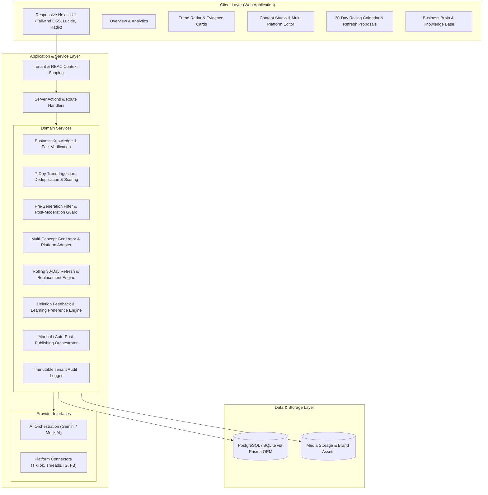
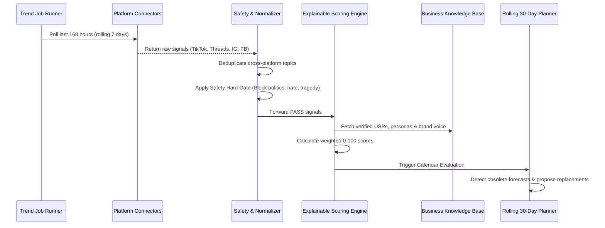
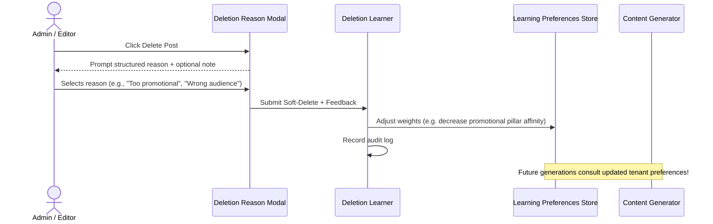

# SYSTEM ARCHITECTURE: TrendPilot

## 1. High-Level Architecture Overview

TrendPilot is architected as a modular, multi-tenant TypeScript application using Next.js 15 App Router, Prisma ORM, and decoupled provider abstractions.



---

## 2. Core Service Boundaries

### 2.1 Tenant & Security Boundary
- Every domain request passes through tenant validation. 
- All Prisma database queries are strictly scoped with `where: { tenantId }`.
- Role permissions are validated both at the API action boundary and the UI component layer.
- Sensitive credentials (e.g. social account OAuth tokens, client secrets) are encrypted using AES-256-GCM before database persistence and never returned to the frontend.

### 2.2 Provider Abstraction Layer

#### AI Orchestration Interface (`AIProvider`)
```typescript
export interface AIProvider {
  name: string;
  generatePostConcepts(input: GenerateConceptsInput): Promise<ContentConcept[]>;
  adaptPlatformCopy(input: AdaptCopyInput): Promise<PlatformCopyVariant>;
  extractKnowledgeFacts(documentText: string): Promise<ExtractedFact[]>;
  evaluateContentSafety(text: string, context: SafetyContext): Promise<SafetyCheckResult>;
  generateVisualAsset(prompt: VisualPromptInput): Promise<GeneratedAssetResult>;
}
```
TrendPilot ships with two implementations:
1. `GeminiProvider`: Connects to Google Gemini (Gemini 2.0 / 1.5 Pro/Flash) for high-speed multi-concept ideation, structured JSON reasoning, and Imagen for visual generation.
2. `MockAIProvider`: Fully deterministic local development and demo provider requiring zero API keys, providing realistic Malaysian and international marketing concepts and verified mock visuals.

#### Platform Connector Interface (`PlatformConnector`)
```typescript
export interface PlatformConnector {
  platform: 'TIKTOK' | 'THREADS' | 'INSTAGRAM' | 'FACEBOOK';
  getCapabilities(): PlatformCapabilities;
  fetchRollingTrends(tenantTimezone: string, lookbackHours: number): Promise<RawTrendSignal[]>;
  validatePost(post: ContentPost, variant: ContentVariant): ValidationResult;
  publishPost(account: SocialAccount, payload: PublishPayload): Promise<PublishResult>;
  fetchPostMetrics(account: SocialAccount, externalPostId: string): Promise<PlatformMetrics>;
}
```
Each connector explicitly declares what it natively supports via `PlatformCapabilities`:
- `trendDiscovery`: boolean
- `publishing`: boolean
- `scheduledPublishing`: boolean
- `mediaUpload`: boolean
- `analytics`: boolean
- `apiComplianceTier`: 'OFFICIAL_PARTNER' | 'GRAPH_API' | 'MOCK_DEMO' | 'RESTRICTED'

---

## 3. The Closed-Loop Trend & Learning Engine

### 3.1 7-Day Trend Intelligence Flow


### 3.2 Deletion & Continuous Learning Feedback Loop


---

## 4. Multi-Tenancy & Data Protection
1. **Tenant Isolation**: Row-level tenant ID enforcement on all tables.
2. **Audit Logging**: Every create, edit, approval, deletion, and auto-post trigger writes an immutable record to `AuditLog`.
3. **Data Residency & PDPA**: Designed with Malaysia's Personal Data Protection Act (PDPA) principles. No customer PII is transmitted to public trend indices or used in public prompts.
4. **Resilient Scheduling**: Publishing jobs are stored with unique idempotency keys (`idempotencyKey = tenantId + postId + scheduledTime`). Even if a job runner restarts, duplicate publishing is prevented.
