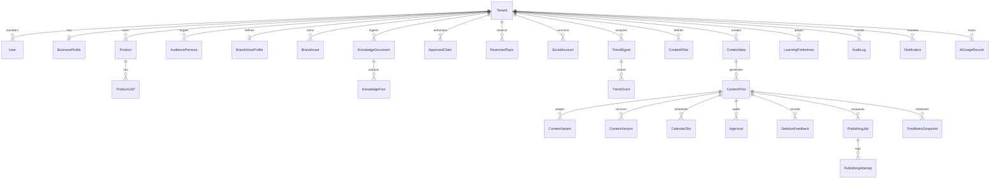

# DATA MODEL: TrendPilot

This document specifies the complete entity-relationship data model for TrendPilot across all 35 required entities. The schema is implemented using Prisma ORM with PostgreSQL compatibility (and SQLite local development support).

---

## 1. Entity Overview & Classification

---

## 2. Entity Specifications

### 2.1 Multi-Tenancy & Identity
1. **Tenant**
   - `id`: String (UUID / CUID) [PK]
   - `name`: String
   - `slug`: String [Unique]
   - `plan`: Enum ('FREE_TRIAL', 'GROWTH', 'ENTERPRISE')
   - `status`: Enum ('ACTIVE', 'SUSPENDED', 'CANCELLED')
   - `timezone`: String (Default: 'Asia/Kuala_Lumpur')
   - `defaultLanguage`: String (Default: 'ms-MY_en')
   - `autoPostEnabled`: Boolean (Default: false)
   - `probationEndsAt`: DateTime (14-day probation window)
   - `maxDailyPosts`: Int (Default: 3)
   - `allowedPostDays`: String (JSON array, e.g. ["MON", "TUE", "WED", "THU", "FRI", "SAT", "SUN"])
   - `allowedTimeWindows`: String (JSON array, e.g. [{"start": "09:00", "end": "21:00"}])
   - `createdAt`: DateTime
   - `updatedAt`: DateTime

2. **User**
   - `id`: String [PK]
   - `email`: String [Unique]
   - `name`: String
   - `passwordHash`: String
   - `avatarUrl`: String?
   - `createdAt`: DateTime
   - `updatedAt`: DateTime

3. **Membership**
   - `id`: String [PK]
   - `tenantId`: String [FK -> Tenant.id]
   - `userId`: String [FK -> User.id]
   - `role`: Enum ('SUPER_ADMIN', 'BUSINESS_ADMIN', 'MARKETING_MANAGER', 'VIEWER')
   - `createdAt`: DateTime

4. **AuditLog**
   - `id`: String [PK]
   - `tenantId`: String [FK -> Tenant.id]
   - `userId`: String?
   - `action`: String (e.g. 'POST_APPROVED', 'POST_DELETED', 'SETTINGS_CHANGED', 'AUTOPOST_TOGGLED')
   - `entityType`: String
   - `entityId`: String
   - `details`: String (JSON)
   - `ipAddress`: String?
   - `createdAt`: DateTime

---

### 2.2 Business Brain & Grounding Facts
5. **BusinessProfile**
   - `id`: String [PK]
   - `tenantId`: String [Unique, FK -> Tenant.id]
   - `industry`: String
   - `location`: String (e.g. "Kuala Lumpur, Malaysia")
   - `website`: String?
   - `contactEmail`: String?
   - `phone`: String?
   - `summary`: String
   - `createdAt`: DateTime
   - `updatedAt`: DateTime

6. **Product**
   - `id`: String [PK]
   - `tenantId`: String [FK -> Tenant.id]
   - `name`: String
   - `category`: String
   - `description`: String
   - `price`: String?
   - `features`: String (JSON array)
   - `benefits`: String (JSON array)
   - `differentiators`: String (JSON array)
   - `isActive`: Boolean (Default: true)
   - `createdAt`: DateTime

7. **ProductUSP**
   - `id`: String [PK]
   - `productId`: String [FK -> Product.id]
   - `title`: String
   - `description`: String
   - `proofPoint`: String
   - `isVerified`: Boolean (Default: true)
   - `createdAt`: DateTime

8. **AudiencePersona**
   - `id`: String [PK]
   - `tenantId`: String [FK -> Tenant.id]
   - `name`: String (e.g. "Urban Coffee Aficionado", "Office Team Lead")
   - `ageRange`: String?
   - `painPoints`: String (JSON array)
   - `motivations`: String (JSON array)
   - `preferredPlatforms`: String (JSON array)
   - `preferredLanguages`: String (JSON array)
   - `createdAt`: DateTime

9. **BrandVoiceProfile**
   - `id`: String [PK]
   - `tenantId`: String [Unique, FK -> Tenant.id]
   - `tone`: String (e.g. "Warm, artisan, knowledgeable, approachable")
   - `personalityTraits`: String (JSON array)
   - `wordsToUse`: String (JSON array)
   - `wordsToAvoid`: String (JSON array)
   - `mixedLanguageAllowed`: Boolean (Default: true)
   - `createdAt`: DateTime

10. **BrandAsset**
    - `id`: String [PK]
    - `tenantId`: String [FK -> Tenant.id]
    - `name`: String
    - `type`: Enum ('LOGO', 'COLOR_PALETTE', 'TYPOGRAPHY', 'PRODUCT_IMAGE', 'TEMPLATE')
    - `url`: String
    - `meta`: String? (JSON)
    - `createdAt`: DateTime

11. **KnowledgeDocument**
    - `id`: String [PK]
    - `tenantId`: String [FK -> Tenant.id]
    - `title`: String
    - `fileType`: String (PDF, DOCX, TXT, CSV)
    - `rawContent`: String
    - `sourceUrl`: String?
    - `processingStatus`: Enum ('PENDING', 'PROCESSED', 'FAILED')
    - `createdAt`: DateTime

12. **KnowledgeFact**
    - `id`: String [PK]
    - `documentId`: String? [FK -> KnowledgeDocument.id]
    - `tenantId`: String [FK -> Tenant.id]
    - `claim`: String
    - `category`: String (e.g. "Pricing", "Ingredient", "Certification", "Policy")
    - `verificationStatus`: Enum ('VERIFIED', 'UNVERIFIED_NEEDS_PROOF', 'EXPIRED')
    - `verifiedByUserId`: String?
    - `verifiedAt`: DateTime?
    - `expiresAt`: DateTime?
    - `createdAt`: DateTime

13. **ApprovedClaim**
    - `id`: String [PK]
    - `tenantId`: String [FK -> Tenant.id]
    - `claim`: String
    - `evidence`: String
    - `allowedPillars`: String (JSON array)
    - `createdAt`: DateTime

14. **RestrictedTopic**
    - `id`: String [PK]
    - `tenantId`: String [FK -> Tenant.id]
    - `topic`: String
    - `reason`: String
    - `severity`: Enum ('HARD_BLOCK', 'REQUIRE_MANUAL_REVIEW')
    - `createdAt`: DateTime

---

### 2.3 Social Connectors & Trend Radar
15. **SocialAccount**
    - `id`: String [PK]
    - `tenantId`: String [FK -> Tenant.id]
    - `platform`: Enum ('TIKTOK', 'THREADS', 'INSTAGRAM', 'FACEBOOK')
    - `accountName`: String
    - `externalAccountId`: String
    - `encryptedAccessToken`: String
    - `tokenExpiresAt`: DateTime?
    - `autoPostEnabled`: Boolean (Default: false)
    - `status`: Enum ('CONNECTED', 'EXPIRED', 'DISCONNECTED', 'PAUSED')
    - `createdAt`: DateTime

16. **PlatformCapability**
    - `id`: String [PK]
    - `platform`: Enum ('TIKTOK', 'THREADS', 'INSTAGRAM', 'FACEBOOK')
    - `supportsTrends`: Boolean
    - `supportsPublishing`: Boolean
    - `supportsScheduledPublishing`: Boolean
    - `supportsAnalytics`: Boolean
    - `tier`: String ('OFFICIAL_GRAPH_API', 'RESEARCH_API', 'MOCK_DEMO')

17. **TrendSource**
    - `id`: String [PK]
    - `name`: String
    - `sourceType`: Enum ('OFFICIAL_API', 'LICENSED_LISTENING', 'MANUAL_IMPORT', 'DEMO_SIMULATOR')
    - `status`: Enum ('ACTIVE', 'DEGRADED', 'OFFLINE')
    - `lastPolledAt`: DateTime?

18. **TrendSignal**
    - `id`: String [PK]
    - `tenantId`: String [FK -> Tenant.id]
    - `sourceId`: String? [FK -> TrendSource.id]
    - `platform`: Enum ('TIKTOK', 'THREADS', 'INSTAGRAM', 'FACEBOOK', 'CROSS_PLATFORM')
    - `externalTrendId`: String?
    - `title`: String
    - `summary`: String
    - `category`: Enum ('EMERGING_TOPIC', 'POPULAR_FORMAT', 'HASHTAG_KEYWORD', 'SEASONAL_MOMENT', 'AUDIENCE_QUESTION', 'INDUSTRY_NEWS')
    - `firstObservedAt`: DateTime
    - `lastObservedAt`: DateTime
    - `sourceUrl`: String?
    - `engagementMetrics`: String (JSON)
    - `isExcluded`: Boolean (Default: false)
    - `exclusionReason`: String?
    - `safetyStatus`: Enum ('PASS', 'MANUAL_REVIEW_REQUIRED', 'BLOCKED')
    - `safetyNotes`: String?
    - `createdAt`: DateTime

19. **TrendSnapshot**
    - `id`: String [PK]
    - `trendSignalId`: String [FK -> TrendSignal.id]
    - `snapshotTime`: DateTime
    - `velocityScore`: Float
    - `rawMetrics`: String (JSON)

20. **TrendScore**
    - `id`: String [PK]
    - `trendSignalId`: String [FK -> TrendSignal.id]
    - `tenantId`: String [FK -> Tenant.id]
    - `recencyScore`: Float (0-100)
    - `momentumScore`: Float (0-100)
    - `businessRelevanceScore`: Float (0-100)
    - `audienceFitScore`: Float (0-100)
    - `platformFitScore`: Float (0-100)
    - `brandFitScore`: Float (0-100)
    - `commercialUsefulnessScore`: Float (0-100)
    - `compositeScore`: Float (0-100)
    - `explanation`: String
    - `matchedProductIds`: String (JSON array)
    - `matchedUSPIds`: String (JSON array)
    - `suggestedAngle`: String
    - `calculatedAt`: DateTime

---

### 2.4 Content Studio & Generation
21. **ContentPillar**
    - `id`: String [PK]
    - `tenantId`: String [FK -> Tenant.id]
    - `name`: String (e.g. "Educational / Coffee Lore", "Behind the Roaster", "Customer Love", "Weekly Special")
    - `targetPercentage`: Int
    - `description`: String

22. **ContentIdea**
    - `id`: String [PK]
    - `tenantId`: String [FK -> Tenant.id]
    - `trendSignalId`: String? [FK -> TrendSignal.id]
    - `pillarId`: String? [FK -> ContentPillar.id]
    - `conceptType`: Enum ('EDUCATIONAL', 'PROBLEM_SOLUTION', 'MYTH_VS_FACT', 'FAQ_OBJECTION', 'BEHIND_SCENES', 'STORYTELLING', 'SHORT_VIDEO_SCRIPT', 'PROMOTIONAL')
    - `title`: String
    - `objective`: String
    - `targetAudience`: String
    - `openingHook`: String
    - `status`: Enum ('DRAFT', 'ACCEPTED', 'REJECTED')
    - `createdAt`: DateTime

23. **ContentPost**
    - `id`: String [PK]
    - `tenantId`: String [FK -> Tenant.id]
    - `ideaId`: String? [FK -> ContentIdea.id]
    - `trendSignalId`: String? [FK -> TrendSignal.id]
    - `productId`: String? [FK -> Product.id]
    - `pillarId`: String? [FK -> ContentPillar.id]
    - `title`: String
    - `masterHook`: String
    - `masterCaption`: String
    - `masterCta`: String
    - `visualBrief`: String
    - `safetyOutcome`: Enum ('PASS', 'MANUAL_REVIEW', 'BLOCKED')
    - `safetyNotes`: String?
    - `lifecycleStatus`: Enum ('IDEA', 'FORECAST', 'DRAFT', 'NEEDS_REVIEW', 'APPROVED', 'SCHEDULED', 'PUBLISHING', 'PUBLISHED', 'FAILED', 'ON_HOLD', 'REPLACEMENT_PROPOSED', 'DELETED')
    - `scheduledFor`: DateTime?
    - `publishedAt`: DateTime?
    - `isDeleted`: Boolean (Default: false)
    - `deletedAt`: DateTime?
    - `createdAt`: DateTime
    - `updatedAt`: DateTime

24. **ContentVariant**
    - `id`: String [PK]
    - `postId`: String [FK -> ContentPost.id]
    - `platform`: Enum ('TIKTOK', 'THREADS', 'INSTAGRAM', 'FACEBOOK')
    - `caption`: String
    - `hook`: String
    - `callToAction`: String
    - `hashtags`: String (JSON array)
    - `aspectRatio`: String (e.g. '9:16', '1:1', '4:5', '16:9')
    - `characterCount`: Int
    - `platformSpecificNotes`: String?

25. **MediaAsset**
    - `id`: String [PK]
    - `tenantId`: String [FK -> Tenant.id]
    - `postId`: String? [FK -> ContentPost.id]
    - `url`: String
    - `prompt`: String?
    - `provider`: String (e.g. "Gemini Imagen / Local Canvas")
    - `aspectRatio`: String
    - `version`: Int (Default: 1)
    - `createdAt`: DateTime

26. **ContentVersion**
    - `id`: String [PK]
    - `postId`: String [FK -> ContentPost.id]
    - `versionNumber`: Int
    - `captionSnapshot`: String
    - `hookSnapshot`: String
    - `changedByUserId`: String?
    - `changeReason`: String?
    - `createdAt`: DateTime

---

### 2.5 Calendar, Approvals & Deletion Learning
27. **CalendarSlot**
    - `id`: String [PK]
    - `tenantId`: String [FK -> Tenant.id]
    - `postId`: String? [FK -> ContentPost.id]
    - `targetDate`: DateTime
    - `slotTime`: String (e.g. "11:30")
    - `platform`: Enum ('TIKTOK', 'THREADS', 'INSTAGRAM', 'FACEBOOK')
    - `isForecast`: Boolean (Default: true)
    - `hasReplacementProposal`: Boolean (Default: false)
    - `proposedReplacementPostId`: String?
    - `replacementReason`: String?

28. **Approval**
    - `id`: String [PK]
    - `postId`: String [FK -> ContentPost.id]
    - `userId`: String
    - `approvalType`: Enum ('MANUAL_ADMIN', 'SYSTEM_AUTOPOST')
    - `notes`: String?
    - `decidedAt`: DateTime

29. **DeletionFeedback**
    - `id`: String [PK]
    - `tenantId`: String [FK -> Tenant.id]
    - `postId`: String [FK -> ContentPost.id]
    - `reasonCategory`: Enum (
        'NOT_RELEVANT',
        'TREND_OUTDATED',
        'WRONG_AUDIENCE',
        'VOICE_MISMATCH',
        'WEAK_COPY',
        'UNSUITABLE_VISUAL',
        'INACCURATE_FACTS',
        'TOO_PROMOTIONAL',
        'SENSITIVE_TOPIC',
        'OFFER_CHANGED',
        'OTHER'
      )
    - `reasonDetails`: String?
    - `improvementText`: String?
    - `rejectedPillarId`: String?
    - `rejectedFormat`: String?
    - `userId`: String
    - `createdAt`: DateTime

30. **LearningPreference**
    - `id`: String [PK]
    - `tenantId`: String [FK -> Tenant.id]
    - `preferenceKey`: String (e.g. 'affinity_educational_pillar', 'tone_weight_playful', 'avoid_format_meme')
    - `weight`: Float (0.0 to 2.0, Default: 1.0)
    - `confidence`: Float (0.0 to 1.0)
    - `sampleCount`: Int (Default: 0)
    - `lastAdjustedAt`: DateTime
    - `isUserOverridden`: Boolean (Default: false)

---

### 2.6 Publishing Jobs & Analytics
31. **PublishingJob**
    - `id`: String [PK]
    - `tenantId`: String [FK -> Tenant.id]
    - `postId`: String [FK -> ContentPost.id]
    - `socialAccountId`: String [FK -> SocialAccount.id]
    - `idempotencyKey`: String [Unique]
    - `scheduledPublishAt`: DateTime
    - `status`: Enum ('PENDING', 'PROCESSING', 'PUBLISHED', 'FAILED', 'CANCELLED')
    - `retryCount`: Int (Default: 0)
    - `maxRetries`: Int (Default: 3)
    - `lastError`: String?
    - `createdAt`: DateTime

32. **PublishingAttempt**
    - `id`: String [PK]
    - `publishingJobId`: String [FK -> PublishingJob.id]
    - `attemptedAt`: DateTime
    - `externalPostId`: String?
    - `responsePayload`: String? (JSON)
    - `isSuccess`: Boolean
    - `errorMessage`: String?

33. **PostMetricSnapshot**
    - `id`: String [PK]
    - `postId`: String [FK -> ContentPost.id]
    - `snapshotDate`: DateTime
    - `impressions`: Int (Default: 0)
    - `reach`: Int (Default: 0)
    - `likes`: Int (Default: 0)
    - `shares`: Int (Default: 0)
    - `comments`: Int (Default: 0)
    - `saves`: Int (Default: 0)
    - `isSimulated`: Boolean (Default: false)

34. **Notification**
    - `id`: String [PK]
    - `tenantId`: String [FK -> Tenant.id]
    - `userId`: String?
    - `title`: String
    - `message`: String
    - `type`: Enum ('HIGH_RELEVANCE_TREND', 'POST_AWAITING_REVIEW', 'REPLACEMENT_PROPOSAL', 'PUBLISHING_SUCCESS', 'PUBLISHING_FAILED', 'SAFETY_ALERT')
    - `isRead`: Boolean (Default: false)
    - `actionUrl`: String?
    - `createdAt`: DateTime

35. **AIUsageRecord**
    - `id`: String [PK]
    - `tenantId`: String [FK -> Tenant.id]
    - `model`: String
    - `operation`: String ('CONCEPT_GEN', 'COPY_ADAPT', 'FACT_EXTRACTION', 'MODERATION', 'IMAGE_GEN')
    - `promptTokens`: Int
    - `completionTokens`: Int
    - `costUsd`: Float?
    - `createdAt`: DateTime
